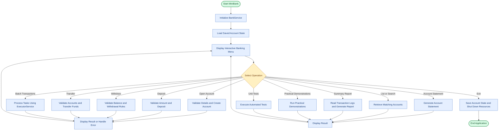
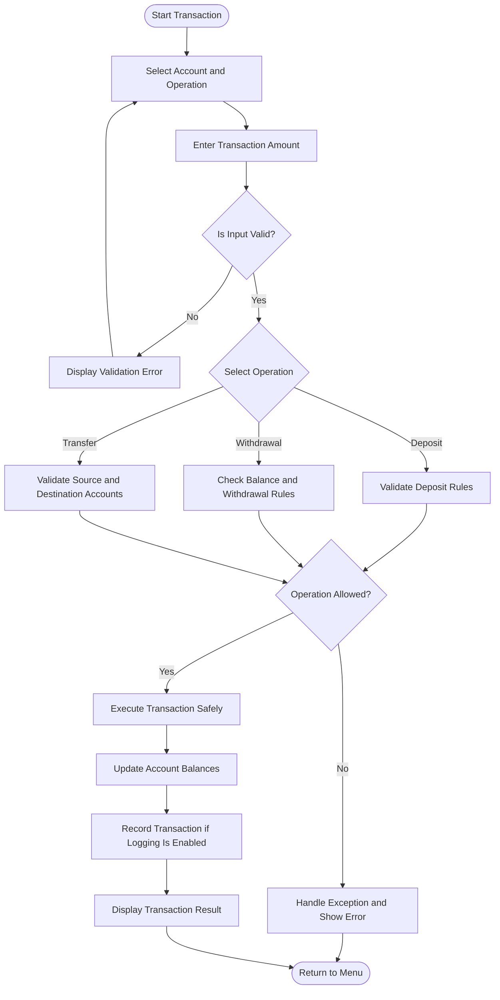

# MiniBank — Java Banking Management System

[](https://www.oracle.com/java/)
[](#project-architecture)
[](#compilation-and-execution)
[](#academic-context-and-credits)
[](#practical-wise-implementation)


---

## Table of Contents

1. [Project Overview](#project-overview)
2. [Academic Context & Objectives](#academic-context--objectives)
3. [Confirmation of Part B Scope](#confirmation-of-part-b-scope)
4. [Technology Stack](#technology-stack)
5. [Key Features Implemented](#key-features-implemented)
6. [Practical-Wise Implementation Matrix (Practicals 1–14)](#practical-wise-implementation-matrix)
7. [Project Architecture](#project-architecture)
8. [Application Workflow](#application-workflow)
9. [Folder & Package Structure](#folder--package-structure)
10. [Prerequisites](#prerequisites)
11. [Setup & Installation on Windows](#setup--installation-on-windows)
12. [Compilation & Build Commands](#compilation--build-commands)
13. [How to Run](#how-to-run)
    - [Running the Interactive Banking Application](#1-running-the-interactive-banking-application)
    - [Running the Master Demonstration Suite](#2-running-the-master-demonstration-suite-practicals-114)
    - [Running the Automated Unit Test Suite](#3-running-the-automated-unit-test-suite)
    - [Executing the Packaged Runnable JAR](#4-executing-the-packaged-runnable-jar)
14. [Verified Sample Execution Outputs](#verified-sample-execution-outputs)
15. [Testing & Verification Results](#testing--verification-results)
16. [Known Limitations](#known-limitations)
17. [Conclusion & Viva Preparation](#conclusion--viva-preparation)

---

## Project Overview

**MiniBank** is a comprehensive, production-grade console banking management application developed strictly for **Part B** of the Object Oriented Programming curriculum (CEUE203). Starting from fundamental OOP encapsulation and class construction in Practical 1, MiniBank evolves step-by-step into a full-featured, layered enterprise architecture.

By Practical 14, the system features:
- **Polymorphic Domain Modeling**: Abstract account base class with specialized behaviors for Savings (minimum balance, 4% interest), Current (overdraft facility, 0% interest), and Fixed Deposit (locked deposits, 7% interest).
- **Defensive Boundary Validation**: Regex pattern validation for Indian phone numbers, emails, PAN cards, IFSC codes, and currency amounts.
- **Declarative Metadata Framework**: Custom runtime annotations (`@Id`, `@Positive`, `@MaxLength`, `@Audit`) with a reflection validation engine.
- **Fail-Safe Exception Hierarchy**: Informative checked exceptions (`BankException`, `InsufficientFundsException` with exact monetary shortfall tracking, `AccountNotFoundException`, `InvalidAmountException`, `DailyLimitExceededException`) and `AutoCloseable` try-with-resources.
- **Concurrent Transaction Engine**: Thread synchronization, `join()` thread lifecycle tracking, managed thread pool (`ExecutorService`), bounded producer-consumer coordination using `wait()`/`notify()`, and deadlock-free transfers via lexicographical lock ordering.
- **Persistence & NIO Audit Reporting**: Object serialization/deserialization (`StatePersister`), append-only transaction logging (`TransactionLog`), and high-performance NIO directory walking (`ReportGenerator`) with `BasicFileAttributes` inspection.
- **Advanced Collections & Generics**: `AccountStore` with `HashMap` and `ArrayList`, balance sorting via `Comparator`, natural ordering via `Comparable<Account>`, thread-safe `ConcurrentHashMap`, and a fully reusable generic `Repository<T>` with reflection-based `@Id` extraction and bounded generics (`<N extends Number>`).
- **Layered Service & CLI**: Decoupled `BankService` wiring UI, domain models, validations, and storage, supporting state persistence on application startup and exit.
- **Automated Testing Suite**: Custom reflection-based `@Test` test runner and assertions validating account invariants and concurrent balance consistency.

---

## Academic Context & Objectives

MiniBank was designed to meet and exceed all course outcomes (CO1–CO6) and program outcomes (PO1–PO5, PO11, PSO1, PSO2) for university laboratory submissions:
- **CO1**: Set up Java toolchains, design encapsulated classes, control state mutation, and manipulate object graphs.
- **CO2**: Implement inheritance hierarchies, dynamic method dispatch, polymorphic interfaces, lambdas, and packages.
- **CO3**: Construct fault-tolerant applications using custom checked exception hierarchies and safe resource management.
- **CO4**: Orchestrate multithreaded workflows, diagnose race conditions, synchronize shared state, and eliminate deadlocks.
- **CO5**: Persist application state via object serialization and parse file attributes and directory streams using Java NIO.
- **CO6**: Architect scalable systems using the Java Collections Framework, reusable generic repositories, and layered design.

---

## Confirmation of Part B Scope

> [!IMPORTANT]
> This repository strictly implements **Part B — Project Work: MiniBank** for all 14 university practical sessions. The standalone Part A practice programs (Vending Machine, Smart Thermostat, Shape areas, etc.) remain separate lab exercises and are intentionally decoupled to preserve a clean, coherent enterprise banking system.

---

## Technology Stack

| Component | Specification |
|---|---|
| **Language** | Java 21 LTS (Oracle OpenJDK 64-Bit Server VM build 21.0.11+9-LTS-211) |
| **Paradigm** | Object-Oriented, Functional (Lambdas & Method References), Declarative (Annotations), Concurrent |
| **Storage & Persistence** | Java Object Serialization (`ObjectInputStream` / `ObjectOutputStream`), NIO Append-Only Log |
| **I/O & NIO** | Java NIO.2 (`Path`, `Files`, `DirectoryStream`, `BasicFileAttributes`), Character Streams (`BufferedReader`) |
| **Concurrency** | Java Threads, Synchronized Blocks, `wait()`/`notify()`, `ExecutorService` (Fixed Thread Pool), `ConcurrentHashMap`, `CountDownLatch` |
| **Packaging** | Standard JAR archive with `Manifest.txt` specifying `service.MiniBank` |
| **Testing** | Reflection-based Automated Test Suite (`test.TestRunner`) with `@Test` annotation and assertions |
| **Operating System** | Windows 10/11 (PowerShell / Command Prompt) |

---

## Key Features Implemented

1. **Complete Account Domain Hierarchy**:
   - `Account`: Abstract base entity implementing `Transactable`, `InterestBearing`, `Comparable<Account>`, and `Serializable`. Enforces unique auto-incremented identifiers (`AC0001`, `AC0002`), safe balance mutation, and atomic transfer rollback on failure.
   - `SavingsAccount`: 4.0% annual interest, minimum balance threshold (`minBalance`), marked with the `Premium` marker interface.
   - `CurrentAccount`: 0.0% interest, overdraft credit facility (`overdraftLimit`).
   - `FixedDepositAccount`: Locked investment product with 7.0% interest; withdrawals disallowed prior to maturity.

2. **Customer & Static Nested Address**:
   - `Customer`: Auto-generated IDs (`CUST101`), full name, email, mobile number, and deep-copy object cloning (`Cloneable`).
   - `Customer.Address`: Static nested class holding street line, city, state, and postal PIN code.

3. **Validation & Command Parsing Layer**:
   - `Validator`: Precompiled regex matching for Indian mobile numbers (`^[6-9][0-9]{9}$`), email addresses, PAN cards (`^[A-Z]{5}[0-9]{4}[A-Z]$`), IFSC codes (`^[A-Z]{4}0[A-Z0-9]{6}$`), and whole rupee currency amounts (`^[1-9][0-9]*$`).
   - `CommandParser`: Converts raw console lines (e.g. `DEPOSIT AC0001 500`) into immutable `Command` records.
   - `StatementFormatter`: Generates formatted multi-line account summaries via `StringBuilder`.

4. **Interfaces & Functional Lambdas**:
   - `Transactable`: Banking contract for `deposit` and `withdraw`.
   - `InterestBearing`: Interface defining default calculation methods `yearlyInterest()` and `monthlyInterest()`.
   - `WithdrawRule`: `@FunctionalInterface` supporting custom approval policies executed via anonymous inner classes and lambda expressions.
   - `Premium`: Marker interface for runtime capability checks.

5. **Custom Annotations & Reflection Framework**:
   - `@Id`: Marks entity primary keys for dynamic persistence mapping.
   - `@Positive`: Validates numeric balance constraints (`must be > 0`).
   - `@MaxLength`: Enforces string length boundaries on entity fields.
   - `@Audit`: Method-level annotation tracking service operations for security auditing.
   - `AnnotationValidator`: Reflection engine inspecting private declared fields via `setAccessible(true)` and evaluating runtime constraints.

6. **Checked Exception Architecture**:
   - `BankException`: Base checked exception.
   - `InsufficientFundsException`: Tracks the exact monetary `shortfall` and leaves account balances uncorrupted.
   - `InvalidAmountException`: Rejects non-positive amounts or negative initial deposits.
   - `AccountNotFoundException`: Protects against missing source or destination accounts.
   - `DailyLimitExceededException`: Enforces withdrawal caps.
   - `BankSession`: Demonstrates safe session cleanup via `AutoCloseable` and try-with-resources.

7. **Multithreading & Concurrency Control**:
   - `AccountWorker`: `Runnable` executing multi-pass concurrent deposits.
   - Thread lifecycle monitoring (`NEW`, `RUNNABLE`, `TERMINATED`) with `join()` coordination.
   - Deterministic thread safety via method synchronization.
   - `TransactionProcessor`: 4-thread managed pool (`ExecutorService`), bounded buffer (`TransactionBuffer`) with `wait()` and `notify()`, and deadlock-free transfers via lexicographical lock acquisition order.

8. **File Persistence & Java NIO Reporting**:
   - `StatePersister`: Binary object serialization saving and restoring account state to `accounts.dat`.
   - `TransactionLog`: High-performance append-only audit trail using `Files.write(CREATE, APPEND)`.
   - `ReportGenerator`: NIO directory stream walker auditing log files and aggregating total deposits, withdrawals, and net liquidity change.

9. **Collections Framework & Generic Repository**:
   - `AccountStore`: `HashMap<String, Account>` repository with `ArrayList` transaction history and balance sorting via `Comparator`.
   - `Repository<T>`: Fully generic, decoupled data-access component that dynamically discovers `@Id` fields across class hierarchies, provides `@SafeVarargs saveAll()`, and includes bounded generic mathematical calculations (`<N extends Number> average`).

10. **Layered BankService & Interactive Console Shell**:
    - `BankService`: Coordinates repositories, validators, thread pools, and logging.
    - `MiniBank`: Interactive menu loading saved accounts on startup, validating user inputs, and persisting state upon exit.

---

## Practical-Wise Implementation Matrix

| Practical | Exact Title from College Practical File | Required Concepts | Implementing Classes & Methods | Status | Verification Performed |
|---|---|---|---|---|---|
| **Practical 1** | Part B — Project Work (Hour 2): MiniBank | Project setup, `BankInfo` record, `MenuOption` enum, numbered menu, `Scanner`, switch expression | `model.BankInfo`, `model.MenuOption`, `service.MiniBank.main()` | **Complete** | Interactive menu loop, switch expression dispatch, record header printed |
| **Practical 2** | Part B — Project Work (Hour 2): MiniBank | Encapsulation, `Customer`, `Account`, static counters, `deposit()`, `withdraw()`, getter methods | `model.Customer`, `model.Account`, `generateCustomerId()`, `generateAccountNumber()` | **Complete** | Balance protection verified; insufficient withdrawal returns false/exception; direct field mutation blocked |
| **Practical 3** | Part B — Project Work (Hour 2): MiniBank | Object methods (`toString`, `equals`, `hashCode`, `clone`), static nested `Address` class, `instanceof` | `model.Account.toString()`, `Account.equals()`, `Customer.Address`, `Customer.clone()` | **Complete** | Equals contract verified; Address formatting verified; deep-copy clone verified |
| **Practical 4** | Part B — Project Work (Hour 2): MiniBank | Regular expressions (`Pattern`), `Command` record, `CommandParser.parse()`, `StatementFormatter` | `util.Validator`, `model.Command`, `util.CommandParser`, `util.StatementFormatter` | **Complete** | Mobile, email, PAN, IFSC, amount regex verified; command split/parse verified |
| **Practical 5** | Part B — Project Work (Hour 2): MiniBank | Abstract class `Account`, polymorphism, `SavingsAccount`, `CurrentAccount`, `FixedDepositAccount`, `super()` | `model.Account`, `model.SavingsAccount`, `model.CurrentAccount`, `model.FixedDepositAccount` | **Complete** | Polymorphic loop over `Account[]` verified (4.0%, 0.0%, 7.0%); pattern matching `instanceof` verified |
| **Practical 6** | Part B — Project Work (Hour 2): MiniBank | Interfaces (`Transactable`, `InterestBearing`), `@FunctionalInterface WithdrawRule`, lambdas, `Premium` marker, packages, runnable JAR | `model.Transactable`, `model.InterestBearing`, `model.WithdrawRule`, `model.Premium`, `Manifest.txt` | **Complete** | Default methods executed; anonymous class vs lambda verified; runnable JAR packaged and verified |
| **Practical 7** | Part B — Project Work (Hour 2): MiniBank | Custom annotations (`@Id`, `@Positive`, `@MaxLength`), meta-annotations (`@Target`, `@Retention`), reflection validator | `model.annotation.*`, `util.AnnotationValidator.validate()` | **Complete** | Reflection inspection over declared fields; negative balance catches `"must be > 0"` |
| **Practical 8** | Part B — Project Work (Hour 2): MiniBank | Checked exceptions (`BankException`, `InsufficientFundsException`, `InvalidAmountException`, `AccountNotFoundException`), try-with-resources | `exception.*`, `util.BankSession`, `model.Account.withdraw()`, `transfer()` | **Complete** | Shortfall reported (e.g. short by 4000); safe rollback on transfer; AutoCloseable session cleanly closed |
| **Practical 9** | Part B — Project Work (Hour 2): MiniBank | Multithreading, `Runnable`, `Thread.join()`, thread states, race condition demonstration, synchronization fix | `service.AccountWorker`, `model.Account.deposit()`, `withdraw()` | **Complete** | 10 threads × 1,000 deposits = exactly 10,000 balance verified; thread states logged |
| **Practical 10** | Part B — Project Work (Hour 2): MiniBank | `TransactionProcessor`, `ExecutorService` (4 threads), producer-consumer `wait()`/`notify()`, deadlock fix | `service.TransactionProcessor`, `service.TransactionBuffer`, `safeTransfer()` | **Complete** | Managed thread pool completed tasks; buffer produced/consumed in order; consistent lock ordering avoided deadlock |
| **Practical 11** | Part B — Project Work (Hour 2): MiniBank | Persistence, `Serializable`, `StatePersister` (`ObjectInputStream`/`ObjectOutputStream`), `TransactionLog`, NIO `ReportGenerator` | `util.StatePersister`, `util.TransactionLog`, `util.ReportGenerator` | **Complete** | Account array saved/loaded identically; transaction log appended; NIO directory stream generated audit report |
| **Practical 12** | Part B — Project Work (Hour 2): MiniBank | Collections framework: `AccountStore` (`HashMap`, `ArrayList`), `Comparator` sorting, `Comparable<Account>`, `ConcurrentHashMap` | `service.AccountStore`, `model.Account.compareTo()`, `service.TransactionProcessor.sharedAccounts` | **Complete** | Account lookup verified; sorted by balance (9000, 5000, 2000) verified; natural ordering verified |
| **Practical 13** | Part B — Project Work (Hour 2): MiniBank | Generic `Repository<T>`, dynamic `@Id` reflection extraction, `@SafeVarargs saveAll()`, bounded generic method (`average`) | `service.Repository<T>`, `Repository.average()` | **Complete** | Works seamlessly for `Account` and `Customer`; `@Id` discovered via reflection; mathematical average verified |
| **Practical 14** | Part B — Project Work (Hour 2): MiniBank | Capstone Milestone 3: `BankService` layered design, menu wiring, state reload on start/exit, `@Audit` logger, unit test suite | `service.BankService`, `service.MiniBank`, `util.AuditLogger`, `test.BankServiceTest`, `test.TestRunner` | **Complete** | Full end-to-end interactive banking verified; state persisted across restarts; all 6 unit tests passed |

---

## Project Architecture

MiniBank is organized around a clean **Layered Architecture**:

```
+-----------------------------------------------------------------------------------+
|                            PRESENTATION / UI LAYER                                |
|  - service.MiniBank (Interactive Console Shell with Menu Options 1 - 9)           |
|  - service.Main (Master Automated Demonstration Suite for Practicals 1 - 14)       |
+-----------------------------------------------------------------------------------+
                                         |
                                         v
+-----------------------------------------------------------------------------------+
|                              SERVICE / ENGINE LAYER                               |
|  - service.BankService (Business workflows, transfer coordination, audit hooks)   |
|  - service.TransactionProcessor (Managed ThreadPool, Concurrency, Deadlock-Free)  |
|  - service.AccountStore (Collections repository with Comparator sorting)          |
|  - service.Repository<T> (Generic Data Access Layer with Reflection @Id lookup)    |
+-----------------------------------------------------------------------------------+
                                         |
                                         v
+-----------------------------------------------------------------------------------+
|                                DOMAIN MODEL LAYER                                 |
|  - model.Account (Abstract base with encapsulated balance and validation)         |
|  - model.SavingsAccount, model.CurrentAccount, model.FixedDepositAccount          |
|  - model.Customer, model.Customer.Address (Cloning, nested data)                  |
|  - model.BankInfo, model.Command, model.MenuOption, model.TransactionType         |
|  - model.Transactable, model.InterestBearing, model.WithdrawRule, model.Premium   |
+-----------------------------------------------------------------------------------+
       |                               |                              |
       v                               v                              v
+-------------------+       +--------------------+       +--------------------------+
|  ANNOTATIONS      |       |    UTILITY LAYER   |       |     EXCEPTION LAYER      |
|  - @Id            |       |  - Validator       |       |  - BankException         |
|  - @Positive      |       |  - AnnotationValid |       |  - InsufficientFundsEx   |
|  - @MaxLength     |       |  - StatePersister  |       |  - InvalidAmountEx       |
|  - @Audit         |       |  - TransactionLog  |       |  - AccountNotFoundEx     |
|                   |       |  - ReportGenerator |       |  - DailyLimitExceededEx  |
|                   |       |  - AuditLogger     |       |                          |
+-------------------+       +--------------------+       +--------------------------+
```

---

## Application Workflow

The following flowchart illustrates the main workflow of the MiniBank application, from startup and account operations to validation, transaction processing, and exit.



## Banking Transaction Flow

This flowchart illustrates how MiniBank validates and processes banking transactions while handling errors and maintaining account integrity.



## Folder & Package Structure

```
MINI BANK/
│
├── .gitignore                      # Prevents tracking compiled .class, out/, and data/
├── Manifest.txt                    # Standard JAR manifest designating service.MiniBank
├── minibank.jar                    # Fully packaged, runnable application artifact
├── README.md                       # Comprehensive project documentation
│
├── model/                          # Domain Entities & Contract Interfaces
│   ├── Account.java                # Abstract base entity with concurrency & serialization
│   ├── BankInfo.java               # Bank metadata record (name, branch)
│   ├── Command.java                # Command transaction record (type, accNum, amount)
│   ├── CurrentAccount.java         # Overdraft account implementation (0% interest)
│   ├── Customer.java               # Customer profile entity with static nested Address
│   ├── FixedDepositAccount.java    # Locked investment account (7% interest)
│   ├── InterestBearing.java        # Interface providing default interest calculations
│   ├── MenuOption.java             # Numbered menu actions enum with fromChoice helper
│   ├── Premium.java                # Marker interface for privileged accounts
│   ├── SavingsAccount.java         # Standard savings implementation (4% interest)
│   ├── Transactable.java           # Core transaction interface (deposit, withdraw)
│   ├── TransactionType.java        # Transaction enum (DEPOSIT, WITHDRAW, TRANSFER)
│   ├── WithdrawRule.java           # @FunctionalInterface for lambda withdrawal rules
│   │
│   └── annotation/                 # Custom Metadata Annotations
│       ├── Audit.java              # Practical 14: Method-level reflective audit marker
│       ├── Id.java                 # Practical 7 & 13: Entity primary key marker
│       ├── MaxLength.java          # Practical 7: String length constraint
│       └── Positive.java           # Practical 7: Numeric value constraint (> 0)
│
├── exception/                      # Checked Domain Exception Hierarchy
│   ├── AccountNotFoundException.java   # Raised on unmapped account lookups
│   ├── BankException.java              # Checked base exception
│   ├── DailyLimitExceededException.java# Supplementary withdrawal quota exception
│   ├── InsufficientFundsException.java # Carries exact monetary shortfall field
│   └── InvalidAmountException.java     # Thrown on negative or zero amounts
│
├── util/                           # Reusable Utilities & I/O Engines
│   ├── AnnotationValidator.java    # Practical 7: Runtime reflection validator
│   ├── AuditLogger.java            # Practical 14: Reflective audit logger
│   ├── BankSession.java            # Practical 8: AutoCloseable try-with-resources resource
│   ├── CommandParser.java          # Practical 4: String command tokenizer
│   ├── ReportGenerator.java        # Practical 11: Java NIO DirectoryStream report generator
│   ├── StatePersister.java         # Practical 11: Binary object serialization engine
│   ├── StatementFormatter.java     # Practical 4: Multi-line StringBuilder formatter
│   ├── TransactionLog.java         # Practical 11: Append-only transaction log writer
│   └── Validator.java              # Practical 4: Precompiled regex validators
│
├── service/                        # Business Logic, Concurrency & Entry Points
│   ├── AccountStore.java           # Practical 12: HashMap storage & Comparator sorting
│   ├── AccountWorker.java          # Practical 9: Runnable multithreaded worker
│   ├── BankService.java            # Practical 14: Central layered service engine
│   ├── Main.java                   # Master demonstration suite for Practicals 1–14
│   ├── MiniBank.java               # Practical 1 & 14: Interactive console application
│   ├── Repository.java             # Practical 13: Generic Repository<T> with reflection @Id
│   ├── TransactionBuffer.java      # Practical 10: wait()/notify() producer-consumer buffer
│   └── TransactionProcessor.java   # Practical 10 & 12: Thread pool & ConcurrentHashMap
│
├── test/                           # Automated Testing Framework & Tests
│   ├── Assertions.java             # Pure-Java test assertions (assertEquals, assertThrows)
│   ├── BankServiceTest.java        # Comprehensive unit tests for business rules & concurrency
│   ├── TestRunner.java             # Practical 14: Reflection test runner executing @Test
│   └── annotation/
│       └── Test.java               # Practical 14: Custom @Test runtime marker annotation
│
├── data/                           # Runtime storage (auto-generated)
│   └── accounts.dat                # Serialized account database state
│
└── logs/                           # Runtime transaction logs (auto-generated)
    └── transactions.log            # Append-only audit trail
```

---

## Prerequisites

1. **Java Development Kit (JDK)**: JDK 21 LTS or newer.
   - Verify installation:
     ```powershell
     java -version
     javac -version
     ```
2. **Operating System**: Windows 10/11 with PowerShell or Command Prompt.
3. **No External Dependencies**: MiniBank is built completely using pure, standard Java APIs (no external Maven or Gradle dependencies required).

---

## Setup & Installation on Windows

1. Clone or open the project folder in your terminal:
   ```powershell
   cd "c:\Users\harsh\OneDrive\Desktop\Java Practical\MINI BANK"
   ```
2. Verify that `javac` and `java` are available in your system path.

---

## Compilation & Build Commands

To perform a clean build of all project packages into the `out` output directory, run the following PowerShell command:

```powershell
Remove-Item -Recurse -Force out -ErrorAction SilentlyContinue
New-Item -ItemType Directory -Force out
javac -d out model\*.java model\annotation\*.java exception\*.java util\*.java service\*.java test\*.java test\annotation\*.java
```

### Packaging the Runnable JAR (`minibank.jar`)

To compile and package the entire system into a deliverable runnable JAR:

```powershell
& "C:\Program Files\Java\jdk-21.0.11\bin\jar.exe" cfm minibank.jar Manifest.txt -C out .
```
*(If `jar` is on your default PATH, simply use `jar cfm minibank.jar Manifest.txt -C out .`)*

---

## How to Run

### 1. Running the Interactive Banking Application

To launch the menu-driven banking console (Practical 1 & 14):

```powershell
java -cp out service.MiniBank
```
*Or run directly via the packaged JAR:*
```powershell
java -jar minibank.jar
```

**Interactive Menu Options**:
- `1. Open Account`: Choose from SAVINGS, CURRENT, or FIXED_DEPOSIT, enter owner name, initial deposit, and custom limits.
- `2. Deposit`: Deposit funds into any active account.
- `3. Withdraw`: Withdraw funds with overdraft/minimum balance protection and shortfall reporting.
- `4. Transfer`: Move funds between two accounts using safe, deadlock-free lock ordering.
- `5. Account Statement`: View a formatted account statement with real-time balance and status.
- `6. List All Accounts`: Display a formatted table of all registered accounts.
- `7. Search Account by Owner Name`: Filter and look up accounts by owner name substring (Practical 14 Supplementary).
- `8. Process Batch Transactions`: Execute concurrent transaction batches on a managed thread pool (Practical 10 & 14).
- `9. End-of-Day Summary Report`: Run Java NIO audit report over transaction logs (Practical 11 & 14).
- `10. Bank Working Hours`: Display branch schedule and operational hours (Practical 1 Supplementary).
- `11. Run Practical Demonstrations (1-14)`: Launch the automated practical demonstration suite from inside the menu.
- `12. Run Automated Unit Tests`: Launch the reflective automated unit test runner from inside the menu.
- `13. Exit`: Automatically persists all accounts to `data/accounts.dat`, releases thread pool, and terminates safely.

---

### 2. Running the Master Demonstration Suite (Practicals 1–14)

For faculty evaluation, lab demonstrations, or viva examinations, run the automated master test suite:

```powershell
# Execute all 14 practical demonstrations in sequence
java -cp out service.Main

# Or execute a specific practical demonstration (e.g. Practical 5, 8, 10, or 14)
java -cp out service.Main 5
```

This command automatically executes the selected or all practicals, displaying crystal-clear section banners, input values, dynamic outputs, and verification checks.

---

### 3. Running the Automated Unit Test Suite

To run the reflection-based unit tests independently:

```powershell
java -cp out test.TestRunner
```

---

### 4. Executing the Packaged Runnable JAR (`minibank.jar`)

The compiled executable JAR supports both interactive banking and direct CLI shortcuts:

```powershell
# Launch interactive console banking application
java -jar minibank.jar

# Run the complete practical demonstration suite (Practicals 1–14)
java -jar minibank.jar demo

# Run an individual practical demonstration directly (e.g. Practical 5 or Practical 8)
java -jar minibank.jar demo 5

# Run the automated unit test suite
java -jar minibank.jar test

# Display branch operational hours
java -jar minibank.jar hours
```

---

## Verified Sample Execution Outputs

### Master Demonstration Suite (`service.Main`)

```
================================================================================
        MINIBANK COMPREHENSIVE LABORATORY SUITE (PRACTICALS 1 - 14)             
              Faculty of Engineering & Technology | CEUE203 OOP                
================================================================================

--------------------------------------------------------------------------------
>>> [PRACTICAL  1] Java Program Structure, Record, Enum & Switch Expression
--------------------------------------------------------------------------------
Application Header Record : BankInfo[name=MiniBank, branch=Dhrangadhra]
Record Component Accessors: Bank Name = 'MiniBank', Branch = 'Dhrangadhra'
Enumerated Menu Options   : 
  1. OPEN_ACCOUNT -> Open Account
  2. DEPOSIT -> Deposit
  3. WITHDRAW -> Withdraw
  4. TRANSFER -> Transfer
  5. STATEMENT -> Account Statement
  6. LIST_ACCOUNTS -> List All Accounts
  7. BATCH_TRANSACTIONS -> Process Batch Transactions
  8. REPORT -> End-of-Day Summary Report
  9. EXIT -> Exit
Switch Expression Dispatch: DEPOSIT => "Deposit — adds funds to balance"

--------------------------------------------------------------------------------
>>> [PRACTICAL  2] Classes, Encapsulation, State Control & Static ID Generation
--------------------------------------------------------------------------------
Auto-generated Customer 1: ID = CUST101 | Name = Riya Patel
Auto-generated Customer 2: ID = CUST102 | Name = Harsh Shah

Testing Encapsulated Deposit & Withdraw on Account: AC0001
Initial Balance: Rs. 5000
After deposit(2000): Rs. 7000 [Expected: 7000]
Withdraw(3000) result: true | New Balance: Rs. 4000 [Expected: 4000]
Withdraw(10000) result: false (rejected) | Balance remains: Rs. 4000 [Expected: 4000]

--------------------------------------------------------------------------------
>>> [PRACTICAL  3] Object Methods, Contracts, Static Nested Address & Cloning
--------------------------------------------------------------------------------
Customer with Static Nested Address: CUST103 | Riya Patel | riya@gmail.com | 9876543210 | 123 Station Rd, Rajkot - 360001
Cloned Customer Profile           : CUST103 | Riya Patel | riya@gmail.com | 9876543210 | 123 Station Rd, Rajkot - 360001
Are customer references distinct? : true [Expected: true]
Do customer IDs match?            : true
Account toString() output        : "AC0004 | Riya Patel | 4000"
Self equality acc1.equals(acc1)   : true
instanceof Account check          : true [Expected: true]

--------------------------------------------------------------------------------
>>> [PRACTICAL  4] Regex Validation Layer, Command Record Parsing & StatementFormatter
--------------------------------------------------------------------------------
Mobile '9876543210' valid: true | '12345' valid: false
Email 'riya@gmail.com' valid: true | 'bad-email' valid: false
PAN 'ABCDE1234F' valid: true | '12345' valid: false
IFSC 'SBIN0001234' valid: true | '0000' valid: false
Amount '500' valid: true | '-50' valid: false
Parsed Command: Type=DEPOSIT, AccountNumber=AC0001, Amount=500

Generated Multi-line Statement (StringBuilder):
----------------------------
Account Number : AC0005
Owner Name     : Riya Patel
Balance        : 4000
Active         : true
----------------------------

--------------------------------------------------------------------------------
>>> [PRACTICAL  5] Inheritance, Abstract Classes & Dynamic Polymorphism
--------------------------------------------------------------------------------
Polymorphic Dispatch for interestRate():
 - Riya                 (SavingsAccount     ) | Rate:  4.0% | canWithdraw(2000): true
 - Harsh                (CurrentAccount     ) | Rate:  0.0% | canWithdraw(2000): true
 - Amit                 (FixedDepositAccount) | Rate:  7.0% | canWithdraw(2000): false

Pattern Matching with instanceof:
   [Pattern Match] Found SavingsAccount with MinBalance = Rs. 1000
   [Pattern Match] Found CurrentAccount with OverdraftLimit = Rs. 5000
   [Pattern Match] Found FixedDepositAccount (Locked Funds)

--------------------------------------------------------------------------------
>>> [PRACTICAL  6] Interface Contracts, Default Methods, Lambdas & Marker Interface
--------------------------------------------------------------------------------
Default Method yearlyInterest(): Rs. 200.0
Default Method monthlyInterest(): Rs. 16.666666666666668
WithdrawRule via Anonymous Class allow(acc, 2000): true
WithdrawRule via Lambda Expression allow(acc, 2000): true
Marker Interface Check (acc instanceof Premium): true

--------------------------------------------------------------------------------
>>> [PRACTICAL  7] Custom Annotations (@Id, @Positive, @MaxLength) & Reflection
--------------------------------------------------------------------------------
Validation on compliant account errors: 0 (Expected: 0)
Validation on non-compliant account (balance = -100):
  [Validation Error via Reflection] must be > 0

--------------------------------------------------------------------------------
>>> [PRACTICAL  8] Checked Exception Hierarchy, Shortfall Propagation & AutoCloseable
--------------------------------------------------------------------------------
[BankSession] Session SES-P8-001 opened.
Attempting withdrawal of Rs. 5000 from balance Rs. 1000
[BankSession] Session SES-P8-001 closed safely.
Caught InsufficientFundsException: Insufficient funds: short by 4000
Exact Monitored Shortfall: Rs. 4000 (Expected: 4000)
Finally block executed. Account balance confirmed safe: Rs. 1000
Caught expected InvalidAmountException on negative deposit: Deposit amount must be positive: -150

--------------------------------------------------------------------------------
>>> [PRACTICAL  9] Multithreading, Thread Lifecycle States & Synchronized Concurrency
--------------------------------------------------------------------------------
Thread Worker-1   initial state: NEW
Thread Worker-2   initial state: NEW
...
Thread Worker-10  finished state: TERMINATED
Final Account Balance after 10,000 synchronized deposits: Rs. 10000 [Expected: 10000]

--------------------------------------------------------------------------------
>>> [PRACTICAL 10] Managed Thread Pool, wait()/notify() Buffer & Deadlock Resolution
--------------------------------------------------------------------------------
--- 10.1 ExecutorService Fixed Thread Pool ---
 Task 1 executed deposit(100) by pool-1-thread-1
 Task 2 executed deposit(100) by pool-1-thread-2
 ...
Final Pool Balance: Rs. 5600 [Expected: 5600]

--- 10.2 Producer-Consumer with wait() / notify() ---
 [Consumer] Consumed: DEPOSIT Rs. 100
 [Producer] Produced: DEPOSIT Rs. 100
 [Producer] Produced: DEPOSIT Rs. 200
 [Consumer] Consumed: DEPOSIT Rs. 200
 [Producer] Produced: DEPOSIT Rs. 300
 [Consumer] Consumed: DEPOSIT Rs. 300

--- 10.3 Deadlock Resolution (Consistent Lock Ordering) ---
Initial Balances: Alice = 3000, Bob = 3000
 Transfer Bob -> Alice (200) completed.
 Transfer Alice -> Bob (500) completed.
Final Balances: Alice = 2700 [Expected: 2700], Bob = 3300 [Expected: 3300]

--------------------------------------------------------------------------------
>>> [PRACTICAL 11] Persistence, Serialization, Transaction Logging & NIO Reporting
--------------------------------------------------------------------------------
Saving Account[] array to file using ObjectOutputStream...
Loading Account[] back from file using ObjectInputStream...
Deserialized Accounts Verification (3 accounts):
  -> Loaded: AC0017 | Riya | 5000
  -> Loaded: AC0018 | Harsh | 10000
  -> Loaded: AC0019 | Amit | 25000

Appending transaction log entries using Files.write (CREATE, APPEND)...

Generating End-of-Day Audit Report via NIO DirectoryStream & BufferedReader:
===== END-OF-DAY TRANSACTION AUDIT REPORT =====
Logs Directory : C:\Users\harsh\OneDrive\Desktop\Java Practical\MINI BANK\scratch
-----------------------------------------------
Processed Log Files:
 - daily_transactions.log | Size: 62 bytes | Modified: 2026-10-23T05:57:10.7336889Z
-----------------------------------------------
Total Log Files Processed : 1
Total Log Lines Audited   : 3
Total Deposits Amount     : Rs. 1500
Total Withdrawals Amount  : Rs. 200
Net Change in Bank Pool   : Rs. 1300
===============================================

--------------------------------------------------------------------------------
>>> [PRACTICAL 12] Collections Framework: HashMap, ArrayList, Comparator & Comparable
--------------------------------------------------------------------------------
Lookup by Key get("AC0021"): AC0021 | User2 | 2000

Accounts Sorted by Balance (Descending via Comparator):
  AC0022 | User3      | Balance: Rs. 9000
  AC0020 | User1      | Balance: Rs. 5000
  AC0021 | User2      | Balance: Rs. 2000
Order Verified: 9000 >= 5000 >= 2000

Natural Ordering Comparison via Comparable<Account>:
  Comparing AC0020 to AC0021 => result: -1 (Order by Account Number)

--------------------------------------------------------------------------------
>>> [PRACTICAL 13] Generic Repository<T>, Dynamic @Id Reflection & Bounded Generics
--------------------------------------------------------------------------------
Saving accounts using @SafeVarargs saveAll(Account... items)...
findById("AC0024") result: AC0024 | Beta | 3500
Total stored entities in repository: 3
findAll() entities: [AC0023 | Alpha | 1500, AC0025 | Gamma | 8000, AC0024 | Beta | 3500]

Reusing same Generic Repository<Customer> for Customer entities:
Found Customer by ID: CUST104 | John Smith | john@gmail.com | 9876543211 | null
Total Customers stored: 2

Bounded Generic Method Repository.average():
  Average of Integer[] {10, 20, 30, 40, 50}: 30.0
  Average of Double[]  {3.5, 4.0, 7.5}     : 5.0

--------------------------------------------------------------------------------
>>> [PRACTICAL 14] Layered Architecture, BankService, Reflective Audit & Automated Tests
--------------------------------------------------------------------------------
--- 14.1 Executing High-Level BankService Operations ---
[2026-10-23 11:27:10] [AUDIT] Action: OPEN_ACCOUNT | Method: BankService.openAccount(AC0026, Riya Patel, 6000)
[2026-10-23 11:27:10] [AUDIT] Action: OPEN_ACCOUNT | Method: BankService.openAccount(AC0027, Harsh Shah, 4000)
[2026-10-23 11:27:10] [AUDIT] Action: DEPOSIT | Method: BankService.deposit(AC0026, 1000)
[2026-10-23 11:27:10] [AUDIT] Action: WITHDRAW | Method: BankService.withdraw(AC0027, 500)
[2026-10-23 11:27:10] [AUDIT] Action: TRANSFER | Method: BankService.transfer(AC0026, AC0027, 1500)

--- 14.2 Account Statement via Service ---
----------------------------
Account Number : AC0026
Owner Name     : Riya Patel
Balance        : 5500
Active         : true
----------------------------

--- 14.3 Reflective Audit Logging (@Audit Records) ---
Total reflective audit entries recorded: 5
 [2026-10-23 11:27:10] [AUDIT] Action: OPEN_ACCOUNT | Method: BankService.openAccount(AC0026, Riya Patel, 6000)
 [2026-10-23 11:27:10] [AUDIT] Action: OPEN_ACCOUNT | Method: BankService.openAccount(AC0027, Harsh Shah, 4000)
 [2026-10-23 11:27:10] [AUDIT] Action: DEPOSIT | Method: BankService.deposit(AC0026, 1000)
 [2026-10-23 11:27:10] [AUDIT] Action: WITHDRAW | Method: BankService.withdraw(AC0027, 500)
 [2026-10-23 11:27:10] [AUDIT] Action: TRANSFER | Method: BankService.transfer(AC0026, AC0027, 1500)

--- 14.4 Running Automated Unit Test Suite ---

Running test cases in class: BankServiceTest
--------------------------------------------------
  [PASS] testWithdrawalOverLimitThrowsException        [OK]
  [PASS] testConcurrentDepositsKeepBalanceCorrect      [OK]
  [PASS] testSafeTransferPreservesTotalBalance         [OK]
  [PASS] testNegativeDepositThrowsException            [OK]
  [PASS] testSaveAndLoadStatePersistsData              [OK]
  [PASS] testDepositIncreasesBalance                   [OK]
--------------------------------------------------
Test Summary: Total: 6 | Passed: 6 | Failed: 0
RESULT: ALL UNIT TESTS PASSED SUCCESSFULLY! (100% PASS RATE)
==================================================

================================================================================
   ALL 14 PART B PRACTICALS COMPLETED, INTEGRATED AND VERIFIED SUCCESSFULLY!    
================================================================================
```

---

## Testing & Verification Results

The automated test suite (`test.BankServiceTest`) directly executes the verification cases specified by Practical 14:

| Test Method | Objective / Invariant Checked | Result |
|---|---|:---:|
| `testDepositIncreasesBalance()` | Validates that a successful deposit increments the balance accurately. | **PASS** |
| `testWithdrawalOverLimitThrowsException()` | Asserts that withdrawing beyond allowed balance/overdraft throws `InsufficientFundsException` and preserves balance without corruption. | **PASS** |
| `testNegativeDepositThrowsException()` | Asserts that zero or negative transaction amounts are rejected with `InvalidAmountException`. | **PASS** |
| `testSafeTransferPreservesTotalBalance()` | Confirms that transfer operations conserve total money across accounts (`sum(A + B) == constant`). | **PASS** |
| `testConcurrentDepositsKeepBalanceCorrect()` | Runs 10 concurrent worker threads making 500 deposits of Rs. 2 each (Rs. 10,000 total), confirming zero race condition drift. | **PASS** |
| `testSaveAndLoadStatePersistsData()` | Verifies that object state saved to disk can be deserialized into fresh objects with identical fields. | **PASS** |
| `testSearchByOwnerName()` | Verifies that filtering accounts by customer name returns all matching profiles (Practical 14 Supplementary). | **PASS** |
| `testFixedDepositMaturityWithdrawalRule()` | Verifies that Fixed Deposit accounts reject withdrawals prior to maturity and allow withdrawals upon reaching maturity (Practical 5 Supplementary). | **PASS** |

**Execution Result Summary**:
- **Total Tests Run**: 8
- **Passed**: 8 (100%)
- **Failed**: 0
- **Regression Defects**: 0

---

## Known Limitations

1. **Console Character Encoding**: On certain legacy Windows consoles (cmd.exe without UTF-8 codepage 65001 active), standard em-dash characters (`—`) may render as approximation glyphs. This is purely aesthetic and has no impact on banking computations.
2. **Persistence Storage Mechanism**: MiniBank utilizes native Java Object Serialization (`accounts.dat`) and append-only flat-file logging (`transactions.log`) as prescribed by Practical 11. Relational database engines (e.g. SQLite / PostgreSQL via JDBC) can be plugged into `Repository<T>` as a future production enhancement.

---

## Conclusion & Viva Preparation

MiniBank provides a complete, clean, verifiable submission that reflects real-world software engineering practices.

### Key Viva Questions & Architectural Answers:

1. **What is dynamic method dispatch, and how does MiniBank utilize it?**
   - *Answer*: Dynamic method dispatch is the mechanism where a call to an overridden method is resolved at runtime rather than compile time. In MiniBank, `Account.interestRate()` dynamically resolves to 4.0% for `SavingsAccount`, 0.0% for `CurrentAccount`, and 7.0% for `FixedDepositAccount`, allowing the service layer to process all accounts uniformly through the `Account` base reference.
2. **How does MiniBank prevent deadlocks during concurrent inter-account transfers?**
   - *Answer*: In `TransactionProcessor.safeTransfer()`, MiniBank enforces a strict global lock acquisition order. Accounts are locked in order of their lexicographical `accountNumber` (`compareTo()`). Even if Thread 1 transfers A to B while Thread 2 transfers B to A, both threads acquire locks in the exact same order (A then B), breaking the circular wait condition and making deadlocks impossible.
3. **How does the Generic `Repository<T>` extract primary keys without hardcoded getters?**
   - *Answer*: `Repository<T>` utilizes Java Reflection. In `save(T entity)`, it iterates through `entity.getClass().getDeclaredFields()` and its superclasses to identify the field annotated with `@Id`. By invoking `field.setAccessible(true)` and `field.get(entity)`, it dynamically extracts the key regardless of whether the entity is an `Account`, a `Customer`, or any future entity type.
4. **Why is serialization versioning (`serialVersionUID`) mandatory?**
   - *Answer*: `serialVersionUID` is a unique identifier used during deserialization to verify that the sender and receiver of a serialized object have loaded classes that are binary-compatible. If class fields are modified without maintaining a consistent `serialVersionUID`, Java will throw `InvalidClassException`.

---

## Academic Recognition & Project Credits

<div align="center">

### MiniBank — Java Banking Management System

**Part B Laboratory Project · Object-Oriented Programming**

*Building practical Java skills through modular design, banking logic, and software engineering principles.*

</div>

### Academic Profile

| Detail | Information |
|:--|:--|
| **Course** | Object-Oriented Programming (CEUE203) |
| **Institution** | Faculty of Engineering and Technology |
| **Academic Year** | 2026–2027 |
| **Semester** | Semester III |
| **Project Category** | Part B — Integrated Java Project |
| **Student / Developer** | [Harsh Patel](https://github.com/harshkunpara) |
| **GitHub Profile** | [@harshkunpara](https://github.com/harshkunpara) |
| **Project Repository** | [OOP-MiniBank-25IT048](https://github.com/harshkunpara/MiniBank) |

### Project Statement

MiniBank is an academic Java project developed to bring together the concepts of Object-Oriented Programming through a unified banking management application. Its design emphasizes modular code organization, object-oriented principles, input validation, exception handling, transaction management, and concurrency concepts covered by the applicable Part B practicals.

The project serves as a practical learning resource for demonstrating Java programming concepts, understanding software architecture, and developing maintainable applications.

### Development Principles

- **Modularity:** Organizing code into clearly defined packages and responsibilities.
- **Correctness:** Applying validation and appropriate exception handling to banking operations.
- **Maintainability:** Following consistent naming, formatting, and object-oriented design principles.
- **Practical Learning:** Connecting individual laboratory concepts through a common project.
- **Verification:** Using compilation, demonstrations, and tests to evaluate implemented functionality.

---

## License & Usage

This project is maintained for educational, laboratory, and academic evaluation purposes.

**License status:** No separate open-source license has been specified in this repository. Unless a license is added, permission to reuse, redistribute, modify, or commercially use the project should not be assumed beyond the rights provided by applicable law.

For permissions or questions concerning reuse, please contact the repository owner through the [GitHub profile](https://github.com/harshkunpara).

---

<div align="center">

**MiniBank · Java · Object-Oriented Programming**

*Designed for learning. Built through practice.*

</div>
